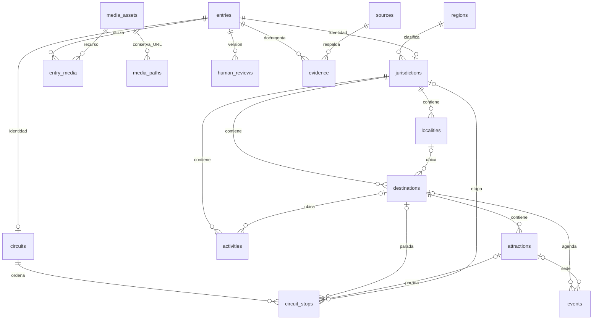

# Modelo y seguridad

## Entidades y relaciones

`public.entries` conserva UUID estable, tipo, slug, nombre, cuerpo **público proyectado**, ruta canónica opcional, coordenadas, verificación y revisión editorial. Los campos privados del maestro nunca van a `body`. Los UUID de importación se obtienen con UUIDv5 del origen, pestaña e ID original; el ID original se conserva además en `editorial.import_rows`. No se recalculan IDs a partir del nombre ni del número de fila de una entidad.

Cada tabla de detalle tiene FK compuesta `(entry_id, entry_kind)` hacia `(id, kind)`, con tipo generado. No se puede asociar una actividad como si fuera una localidad.

- `regions`: taxonomía estática, sin fichas editoriales ni datos privados. Se conservan las seis regiones del catálogo y el criterio de La Pampa del PR01; no se reclasifica el país.
- `jurisdictions`: 23 provincias y CABA; región y capital. `localities` representa una localidad administrativa; `destinations` un destino editorial, con localidad opcional y jurisdicción obligatoria. Una localidad puede contener muchos destinos/atractivos, no una ficha única por ciudad. La FK compuesta de localidad/destino exige que pertenezcan a la misma jurisdicción.
- `attractions`: pertenecen a un destino. `activities`: actividades/experiencias, jurisdicción obligatoria y destino opcional coherente. Las ubicaciones del catálogo actual permanecen como texto hasta resolverlas documentalmente; no se deducen localidades desde comas ni coordenadas.
- `circuits` y `circuit_stops`: PDF/duración textual y paradas ordenadas. Cada parada refiere a **un** destino, atractivo o jurisdicción. Así un circuito puede cruzar provincias sin una columna de provincias separadas por comas. No se inventan orden, logística, duración numérica o paradas desde el PDF.
- `events`: fechas con zona horaria, sede y texto original de fecha. Fechas incompletas pueden permanecer nulas en staging; la política de lectura de detalles exige ambas fechas. No se infiere el año de la fecha de consulta. Archivo/vencimiento sigue resolviéndose en el lector actual durante la transición. Esta futura tabla conserva también eventos históricos; el futuro consumidor debe separar próximos y archivo con la fecha real.
- Artículos/planes/noticias y preguntas editoriales pueden usar `entries(kind='article')`; no se crea una tabla idéntica por cada sección. Antes de importar servicios/oficinas/agencias, definir su especialización: por ahora solo staging privado, sin forzarlos a atractivos.
- `media_assets`, `entry_media`, `media_paths`: metadatos, ubicación física, derechos, orden, texto alternativo y muchas URLs históricas hacia un mismo objeto. `original_path` es el representante; `media_paths` conserva todos los alias de los duplicados. La identidad del recurso y la de cada ficha son independientes.
- `route_aliases`: prepara los redirects permanentes de páginas hacia una ficha canónica; no se cambia el redirect actual de Next ni se consume esta tabla todavía.

## Documentación, revisión y publicación

Un registro nace `unreviewed` / `pending` / `publication_permitted=false`. Son tres dimensiones diferentes. `verified` no significa aprobado. La publicación exige verificación, fecha de verificación, aprobación, fecha y coincidencia exacta de `approved_version=content_version`, incluida la comprobación explícita de valores no nulos.

`editorial.human_reviews` registra revisor humano de `auth.users`, versión, decisión, alcance por campos, fecha y notas. `editorial.members` prepara los roles researcher/editor/reviewer/publisher sin altas ni políticas de escritura desde el navegador. Solo reviewer/publisher puede respaldar una publicación; no se confía en `user_metadata`, JWT ni en el mero hecho de estar autenticado. No se implementa Auth ni panel administrativo.

Un trigger exige la revisión privada de esa versión y fecha. El alcance debe incluir `name`, `slug`, ruta/coordenadas si están presentes, cada clave `body.<campo>` y `details` para entidades con detalle. Una aprobación parcial no habilita un cuerpo más amplio. `body` debe contener exclusivamente la proyección saneada a revisar: no volcar `original_payload` ni notas de investigación.

Cambiar contenido base, una relación, una parada, un medio asociado o un detalle incrementa la versión y retira aprobación y publicación. El proceso futuro debe volver a presentar la versión resultante después de completar todos los detalles. Cambiar fuentes privadas no publica nada ni actualiza silenciosamente el texto público. Despublicar un padre oculta sus detalles dependientes por RLS; el registro base de un hijo con aprobación propia conserva su propia política. El futuro servicio editorial deberá validar dependencias y resolver despublicaciones en una transacción; no hay una API de publicación en PR09.

Las revisiones humanas y el historial son append-only para `service_role`. El propietario de la base sigue teniendo privilegios administrativos: RLS no protege frente a un administrador de base comprometido. No se ofrece un flujo de aprobación completo ni se autoriza a un importador a emitir decisiones humanas.

## Esquema privado

`editorial` no debe exponerse en Data API ni GraphQL. Todas sus tablas tienen RLS y carecen de grants/políticas para `anon` y `authenticated`.

| Tabla | Propósito |
| --- | --- |
| `sources` | IDs originales F-*, URL, institución, consulta, alcance original |
| `evidence` | IDs EV-*, entidad, campo, hallazgo, fuente, localizador y fecha |
| `variable_facts` + `fact_evidence` | V-*, importe/moneda opcionales, vigencia, fuentes y múltiples evidencias |
| `human_reviews` + `members` | Decisiones humanas por versión y autorización futura administrada desde servidor |
| `import_batches` + `import_rows` | Origen, revisión del maestro, checksum, claves idempotentes y payload original sin pérdidas |
| `revisions` | Antes/después, tabla, operación, rol, usuario, fecha y lote opcional |

Los datos variables **no se publican en esta versión**: `variable_facts.publication_permitted` tiene un CHECK que obliga a `false`. Los tres casos numéricos del contexto necesitan decisión separada; una aprobación del texto base no los habilita. `original_payload` preserva campos desconocidos y estados textuales sin convertirlos en permisos.

Auditoría mediante triggers invoker, sin `SECURITY DEFINER` ni vistas que eludan RLS. Todas las FKs tienen índices utilizables; los padres y checks críticos usan PK/unique. El índice parcial de publicación favorece lecturas por tipo/slug. No se instala PostGIS hasta justificar búsquedas de proximidad reales; las coordenadas actuales se conservan como pares validados. No se introducen conexiones PostgreSQL por visitante ni pooling adicional.

## Storage

| Bucket | Entrega | Uso y límite por objeto |
| --- | --- | --- |
| `tourism-published` | Público, vacío inicialmente | Solo copias aprobadas, derechos verificados; imágenes/PDF, 50.000.000 bytes |
| `editorial-private` | Privado | Evidencias, originales pendientes y Excel; 50.000.000 bytes |
| `advertising-private` | Privado | Banners todavía no publicables; 10 MiB |

No hay políticas permisivas de lectura/subida/edición/eliminación para roles del navegador. Una política restrictiva impide que otra política permisiva genérica abra estos buckets. Un futuro backend autorizado usará privilegios separados, jamás el cliente público del sitio. Para upsert, cualquier futuro rol de editor necesita SELECT+INSERT+UPDATE con el mismo predicado y autorización administrada en servidor; no basta un `TO authenticated`. No se habilita ese rol ahora.

**Un bucket público entrega un objeto conocido sin evaluar RLS de SELECT.** Por eso los borradores y evidencias deben permanecer privados. RLS de `media_assets` no convierte en privado un archivo ya subido al bucket público. El futuro publicador debe verificar derechos, aprobación, MIME real, tamaño, SHA-256, contenido seguro de SVG, relaciones y huella de contenido antes de copiarlo. No modificar `storage.objects` directamente para subir/borrar objetos: usar Storage API, sin dejar metadatos huérfanos.

Claves propuestas ASCII e inmutables: `sha256/<dos-primeros-caracteres>/<hash>.<ext>`, conservando todas las rutas originales en el manifiesto. Nunca sobrescribir un objeto de distinto hash. Mantener límites globales y por bucket compatibles; no activar transformaciones de pago. Una copia pública retirada puede permanecer en cachés/CDN: la reversión requiere manejar caché, no prometer revocación instantánea.

## Publicidad futura (diseño, sin tablas ni ejecución)

Reservar `advertisers` → `campaigns` → `creatives` (FK a recurso multimedia) y `placements`; relación `campaign_placements` para fechas, prioridad y espacios. Cada campaña/creativo requerirá vigencia inicio/fin, aprobación por versión, permiso de publicación y URL HTTPS validada. Agregar métricas diarias por campaña/ubicación como contadores agregados, sin identificadores de visitante, IP ni seguimiento individual.

No se crean estas tablas hasta cerrar el contrato comercial; no hay banners visibles, SDK de anuncios, clics medidos ni campañas activas. Antes de activarlos será obligatorio revisar el aviso de privacidad que actualmente declara ausencia de publicidad y las necesidades de consentimiento. PR09 no cambia esas declaraciones.
